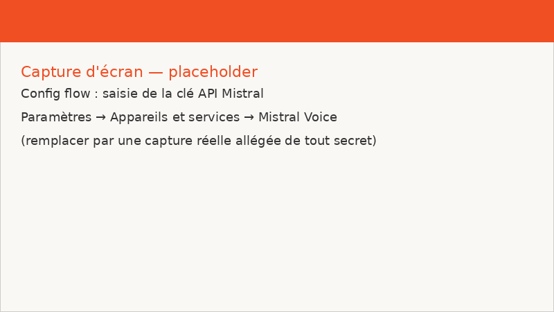
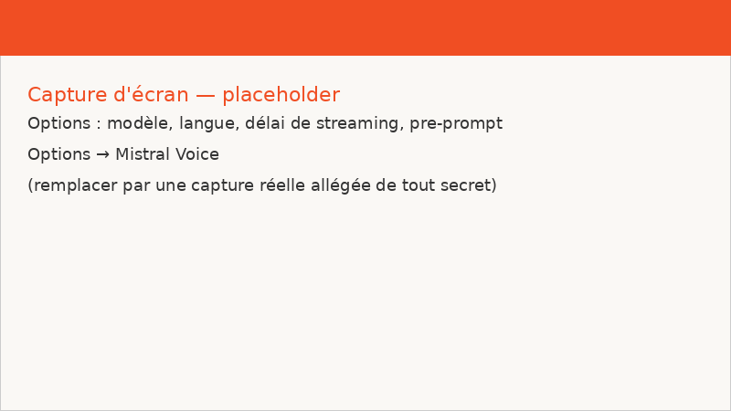

# Mistral Voice


[](https://my.home-assistant.io/redirect/hacs_repository/?owner=pierrepinon&repository=ha-mistral-voice&category=integration)

Intégration Home Assistant custom pour un **assistant vocal 100 % cloud via
l'API Mistral** : transcription en flux (STT), agent de conversation avec
outils **et mémoire des tours précédents**, synthèse vocale en flux (TTS),
pensés pour les satellites
[Home Assistant Voice PE](https://www.home-assistant.io/voice-pe/) et toute
installation HAOS ~2026.10.x.

- **Aucun GPU local** : la voix est traitée par `api.mistral.ai`.
- **Aucune exposition entrante** : uniquement des connexions HTTPS/WSS
  **sortantes** vers `api.mistral.ai` (voir notre
  [décision d'architecture](docs/adr/0001-traitement-100-cloud-mistral.md)).
- **Clé API jamais en clair** : saisie une fois dans le config flow, stockée
  chiffrée par Home Assistant, jamais loguée ni réaffichée.

## Architecture

```
┌─────────────────┐        ┌────────────────────────────────┐
│  Voice PE       │  flux  │   Home Assistant (HAOS)        │
│  (satellite)    │───────▶│   Pipeline Assist              │
│  micro + audio  │        │  ┌──────────────────────────┐  │
└─────────────────┘        │  │ STT  : Transcription     │  │
                           │  │       (Mistral) en flux  │──┼──▶ WSS
                           │  ├──────────────────────────┤  │    wss://api.mistral.ai/
                           │  │ Agent : Mistral Voice    │  │    /v1/audio/transcriptions/
                           │  │       (chat + outils HA) │──┼──▶ HTTPS
                           │  ├──────────────────────────┤  │    api.mistral.ai/v1/chat/completions
                           │  │ TTS : Synthèse vocale    │  │    api.mistral.ai/v1/audio/speech
                           │  │      (Mistral)           │──┼──▶ HTTPS
                           │  └──────────────────────────┘  │
                           └────────────────────────────────┘
```

Toutes les flèches partent de Home Assistant : **HTTPS/WSS sortant
uniquement**, aucun port ouvert, aucune règle de pare-feu entrante.
La transcription en flux passe par un WebSocket initialisé par session
(config → `input_audio.append` → `input_audio.end` → deltas →
`transcription.done`), l'agent de conversation et le TTS répondent **en
flux SSE** (POST /v1/chat/completions puis /v1/audio/speech) : les deltas
de l'agent et les chunks audio du TTS arrivent au fil de l'eau, le
satellite joue la réponse avant qu'elle soit entièrement générée.

## Installation via HACS (one-click)

1. Installer [HACS](https://hacs.xyz/) si ce n'est pas déjà fait.
2. **Bouton one-click** : cliquer le badge ci-dessous (ou utiliser le lien
   direct du dépôt `https://github.com/pierrepinon/ha-mistral-voice`) :

   [](https://my.home-assistant.io/redirect/hacs_repository/?owner=pierrepinon&repository=ha-mistral-voice&category=integration)

3. Méthode manuelle équivalente : dans HACS → ⋮ → **Dépôts personnalisés**,
   ajouter :
   - URL : `https://github.com/pierrepinon/ha-mistral-voice`
   - Catégorie : **Intégration**
   puis installer **Mistral Voice** et redémarrer Home Assistant.
4. Paramètres → Appareils et services → **Ajouter une intégration** →
   **Mistral Voice**.

## Captures d'écran

Des captures de l'installation (config flow, options, debug du pipeline)
seront ici. Des images d'illustration sont fournies en attendant :

| Config flow (clé API)          | Options (modèle, langue, délai)       |
| ------------------------------ | ------------------------------------- |
|  |  |

> Ces images sont des **placeholders**, remplacées avant la release par des
> captures réelles — soigneusement allégées de tout secret (cf. FAQ).

## Configuration

### Clé API Mistral

- La clé vit dans votre gestionnaire de mots de passe (ex. **Bitwarden**) :
  copiez-la depuis là-bas et collez-la dans le config flow, champ masqué.
- **Jamais** de clé en clair dans un fichier, une note, un commit ou une
  capture d'écran ; **jamais** de valeur exemplaire dans la doc : si vous
  faites une capture, floutez le champ (HA masque déjà la saisie).
- Elle est stockée uniquement dans `entry.data` de Home Assistant (chiffrée
  au repos), lue à l'exécution seule, et n'apparaît jamais dans les logs.

### Config flow

Au premier ajout de l'intégration : un unique champ masqué « Clé API
Mistral ». Une seule instance de l'intégration est permise ; la saisie d'une
clé vide est refusée.

### Options

Options → Mistral Voice :

| Option | Défaut | Rôle |
| --- | --- | --- |
| **Modèle de chat Mistral** | `mistral-small-latest` | Choisi dans une liste **dynamique** alimentée par `GET /v1/models` (modèles de chat, alias `-latest` en premier) ; une valeur personnalisée peut être saisie. |
| **Rafraîchir les modèles** | décoché | Cocher puis valider pour réinterroger la liste des modèles sans enregistrer. |
| **Langue de transcription** | `fr` | Langue passée à la session de transcription (`fr`, `en`, `de`, `es`, `it`) ; le fournisseur TTS ne sert que les pipelines dans cette langue. |
| **Délai de streaming cible** | `480` | `target_streaming_delay_ms` en ms, plage **80–2400**. |
| **Voix de synthèse vocale** | (vide = voix par défaut) | Identifiant d'une voix Mistral (préréglée ou clonée) passé à `POST /v1/audio/speech`. |
| **Pre-prompt système** | (vide = pre-prompt français intégré) | Surcharge du pre-prompt par défaut. |

En cas d'API injoignable pendant le rafraîchissement : une erreur est
affichée (`models_fetch_failed`) et **la valeur du modèle courant est
conservée** — un pépin réseau ne casse jamais votre configuration.

### Pre-prompt par défaut

Envoyé en message système à chaque appel de conversation (voir
`custom_components/mistral_voice/const.py`, `DEFAULT_SYSTEM_PROMPT`) :

> « Tu es l'assistant vocal de la maison, joignable par la voix via Home
> Assistant. Règles : toujours répondre en français, à l'oral, concis
> (phrases courtes, pas de listes sauf si demandé) ; contrôler la maison
> uniquement via les outils fournis, jamais répondre "je ne peux pas" quand
> un outil existe ; ne jamais inventer l'état d'un appareil, le lire
> d'abord ; demander une confirmation orale avant toute action irréversible
> (alarme, portail, suppression) ; en cas d'ambiguïté, demander une
> précision courte ; ne jamais mentionner que tu es un modèle ou que tu
> utilises des outils. »

## Fonctionnement

### Transcription en flux (STT)

L'intégration fournit un fournisseur STT, entité **« Transcription
(Mistral) »**, implémentant `SpeechToTextEntity`. À chaque énoncé du
pipeline Assist :

1. Home Assistant ouvre une session WebSocket de transcription temps réel
   vers `wss://api.mistral.ai/v1/audio/transcriptions/realtime?model=voxtral-mini-transcribe-realtime-3`,
   via le SDK `mistralai[realtime]`.
2. Les chunks PCM (linéaire 16 bits, mono, 16 kHz) du pipeline sont pompés
   vers la session (`input_audio.append`), puis `input_audio.end`.
3. Les deltas de transcription arrivent en flux, puis `transcription.done`
   porte le texte final, renvoyé au pipeline (`SpeechResult.SUCCESS`).

Le modèle de transcription est fixe (`voxtral-mini-transcribe-realtime-3`) ;
la langue et le délai de streaming cible viennent des options. Le streaming
ne gère pas le barge-in : les résultats partiels sont ignorés par le
pipeline, l'interruption vient du VAD/AEC du satellite Voice PE. Une
connexion WebSocket par énoncé, fermée proprement (`finally`) dans tous les
cas ; une erreur de session renvoie `SpeechResultState.ERROR` et aucun
secret n'apparaît dans les logs.

### Agent de conversation et outils HA

Quand un énoncé est transcrit, l'agent **Mistral Voice** (entité
conversation Home Assistant) est interrogé par le pipeline Assist :

1. Le pipeline ouvre le `ChatLog` de la conversation : l'agent y retrouve
   **l'historique des tours précédents** (questions, réponses, appels
   d'outils et résultats) — les demandes de suivi (« et à côté ? »,
   « allume-la aussi ») fonctionnent. L'historique envoyé au modèle est
   plafonné (40 messages, coupure sur une frontière de tour utilisateur).
2. Les outils LLM de HA (API Assist : `HassTurnOn`, etc., issus des entités
   exposées à Assist) sont convertis au schéma **function-calling** Mistral
   (`{"type": "function", "function": {…}}`) — le mécanisme d'outils de HA
   n'est pas réimplémenté.
3. Un appel `POST /v1/chat/completions` **en flux SSE** est fait avec le
   pre-prompt et les outils, `tool_choice="auto"`, `max_tokens` capé à 150 ;
   les deltas de contenu sont poussés dans le `ChatLog` et peuvent être
   diffusés au TTS au fur et à mesure (l'agent déclare
   `supports_streaming`).
4. Si le modèle demande un outil, il est exécuté **côté HA** via l'API
   LLM, le résultat repart en message `tool`, et la conversation reboucle
   (5 itérations max) jusqu'au texte final.
5. Le texte final (français, style parlé) est renvoyé au pipeline, puis
   synthétisé par le TTS du pipeline.
6. En cas d'erreur (API injoignable, outil en échec), une réponse polie en
   français est renvoyée : pas d'exception exposée, jamais de secret.

> Compatibilité : l'agent reste enregistré sous l'id de l'entrée en plus
> de son entité — les pipelines configurés sur « Mistral Voice »
> fonctionnent sans changement après la mise à jour.

### Synthèse vocale (TTS)

L'intégration fournit un fournisseur TTS, entité **« Synthèse vocale
(Mistral) »**, implémentant `TextToSpeechEntity` :

1. **Sans flux** (service `tts.speak`) : un appel
   `POST /v1/audio/speech` (`voxtral-mini-tts-3-0`) renvoie l'audio
   complet en base64, décodé et rendu avec son extension.
2. **En flux** (pipeline Assist / satellite vocal) : l'appel part avec
   `stream=True` et l'audio arrive en événements `speech.audio.delta`,
   décodés et diffusés au pipeline chunk par chunk — le satellite vocal
   commence à jouer avant la fin de la génération (latence au premier
   audio réduite, silence de fin raccourci).
3. Le format est celui du consommateur : l'option Home Assistant
   `preferred_format` est supportée, le satellite Voice PE reçoit du WAV
   16 kHz/16 bits/mono natif (MP3/FLAC/Opus sinon, MP3 par défaut),
   jamais de conversion ffmpeg sur du PCM brut. En cas d'échec, l'erreur
   remonte en `HomeAssistantError` générique — jamais de clé ni de
   texte parlé dans les logs.

La voix suit l'option **Voix de synthèse vocale** ; la langue supportée
suit l'option **Langue de transcription** (le pipeline utilise STT et
TTS dans la même langue) et l'entité partage l'appareil de service des
autres entités.

## FAQ

**Q : Où ma clé API est-elle stockée ?**
R : Uniquement dans l'entrée de configuration Home Assistant (`entry.data`),
chiffrée au repos par HA. Elle n'est jamais écrite dans un fichier du dépôt,
jamais loguée, jamais réaffichée. Sa source : votre gestionnaire de mots de
passe (elle est copiée à la main depuis Bitwarden lors de l'installation).

**Q : Faut-il ouvrir un port sur mon routeur ?**
R : Non. Tout le trafic est **sortant** (HTTPS/WSS vers `api.mistral.ai`).
Aucune exposition entrante de Home Assistant.

**Q : Le STT partage-t-il mon audio ?**
R : Oui, l'audio du satellite transite par `api.mistral.ai` (décision
[ADR-0001](docs/adr/0001-traitement-100-cloud-mistral.md)): 100 % cloud.
Confidentialité : cf. politique Mistral. Aucun audio n'est stocké localement.

**Q : Quels modèles sont supportés ?**
R : Tous les modèles de chat annoncés par `GET /v1/models` — aucun modèle
n'est figé en dur dans le code. Les alias « -latest » sont mis en premier.
Pour la transcription, le modèle temps réel actuellement supporté est
`voxtral-mini-transcribe-realtime-3`.

**Q : Pourquoi mes commandes ne font rien ?**
R : Vérifiez que les entités visées sont **exposées à Assist** (Paramètres →
Appareils et services → Assistants vocaux → entités exposées) et que le
pipeline utilisé a Mistral Voice comme agent de **conversation** et comme
fournisseur **STT**. Vérifiez aussi que le pipeline a bien l'entité
**« Synthèse vocale (Mistral) »** comme fournisseur **TTS** : sans lui,
les commandes sont comprises et exécutées mais rien n'est parlé.

**Q : Comment faire une capture d'écran sans exposer de secret ?**
R : Ne le faites pas : masquez tout champ de clé (HA masque déjà la saisie)
et toute ligne de log contenant des identifiants. En cas de doute,
floutez l'image.

**Q : L'intégration fonctionne hors ligne ?**
R : Non, elle est 100 % cloud (ADR-0001) : sans réseau vers
`api.mistral.ai`, la transcription, la conversation et la synthèse vocale
renvoient des erreurs
polies, et l'intégration récupère automatiquement dès que le réseau revient.

## Tests manuels (à passer avant chaque release)

### 1. Installation one-click via HACS

1. Dans une instance HAOS de test avec HACS : cliquer le badge d'installation
   (ou ajouter le dépôt manuellement, catégorie **Intégration**).
2. Installer, redémarrer HA, ajouter l'intégration (clé API).
3. Attendu : l'entrée apparaît dans Paramètres → Appareils et services, avec
   une entité **« Transcription (Mistral) »** (STT), une entité
   **« Synthèse vocale (Mistral) »** (TTS) et l'agent **Mistral
   Voice** sélectionnable comme agent de conversation.

### 2. STT streamé (debug du pipeline)

1. Paramètres → Voice assistants → votre pipeline → **Débug** (ou Settings →
   Voice assistants → Debug).
2. Vérifier que le **STT** du pipeline est l'entité **Transcription
   (Mistral)** et le **TTS** l'entité **Synthèse vocale (Mistral)**.
3. Depuis le satellite Voice PE (ou le bouton micro du debug), dicter une
   phrase (ex. « Quelle heure est-il ? »).
4. Attendu : « Texte reconnu » s'affiche **en flux** (deltas puis texte
   final), sans erreur dans les logs, et aucune trace de clé API.

### 3. Tool calling sur une entité réelle

1. Exposer une entité allumable (ex. une **lampe**) à Assist.
2. Parler/écrire : « Allume la lampe ».
3. Attendu : la lampe bascule (état vérifié dans l'UI), la réponse vocale
   annonce l'action, et les logs montrent une requête `chat/completions`
   incluant des `tool_calls` puis un message `tool` (sans secret).
4. Cas de repli : couper le réseau avant de parler → la réponse polie
   « Désolé, je n'ai pas réussi à traiter votre demande. Veuillez réessayer
   dans un instant. » est renvoyée, aucune exception n'apparaît dans les
   logs, et tout remarche dès le retour du réseau.

### 4. Mémoire de conversation (1.2.0)

1. Parler : « Quelle température fait-il au salon ? ».
2. Puis, dans la même conversation : « Et à côté ? ».
3. Attendu : la deuxième réponse cible la pièce demandée — la requête
   envoyée à Mistral contient l'historique (`user`/`assistant`) du tour
   précédent (visible en log debug, sans secret).

### 5. TTS en flux (1.2.0)

1. Pipeline → satellite Voice PE : dicter une phrase demandant une
   réponse longue (ex. « Raconte-moi ta journée »).
2. Attendu : le satellite commence à parler **avant** la fin de la
   génération (chunks `speech.audio.delta`), la requête part avec
   `stream=true` et `response_format=wav`, sans erreur ffmpeg dans les
   logs.

## Contrat API Mistral utilisé

### WebSocket temps réel (transcription)

- URL : `wss://api.mistral.ai/v1/audio/transcriptions/realtime?model=voxtral-mini-transcribe-realtime-3`
  (auth : `Authorization: Bearer <clé>`, fournie par le SDK à partir de
  `entry.data["api_key"]`).
- Ouvrir avec `audio_format` PCM s16le (mono, 16 kHz),
  `target_streaming_delay_ms` (80–2400) et `language` des options.
- Séquence d'événements :

```
client ──▶ session config            (à l'ouverture, via realtime.connect)
client ──▶ input_audio.append × N    (chunks audio, base64)
client ──▶ input_audio.end           (fin de parole)
serveur ◀── transcription.text.delta (partials ; ignorés par le pipeline HA)
serveur ◀── transcription.segment    (segments finalisés)
serveur ◀── transcription.done       (texte complet, langue, usage)
```

- Erreurs : événement de type erreur → la session est refermée et le
  pipeline reçoit `SpeechResultState.ERROR`.

### Chat completions (agent de conversation)

- `POST /v1/chat/completions` **en flux SSE** (`client.chat.stream_async`)
  avec :
  - `model` : le modèle choisi (options), issu de `GET /v1/models` ;
  - `messages` : pre-prompt système + historique de la conversation
    (user / assistant / tool, plafonné à 40 messages) ;
  - `tools` / `tool_choice="auto"` : outils Assist de HA convertis au
    schéma `{"type": "function", "function": {"name", "description",
    "parameters"}}` (JSON Schema des paramètres) ;
  - `max_tokens` : 150 (réponses courtes, style parlé).
- Boucle de tool calling : deltas `tool_calls` (arguments assemblés par
  index) → exécution côté HA via l'API LLM → messages
  `{"role": "tool", "tool_call_id", "content"}` → nouvel appel,
  max 5 itérations. Les deltas de contenu sont poussés dans le `ChatLog`
  HA (diffusables au TTS par le pipeline).

### Audio speech (synthèse vocale)

- `POST /v1/audio/speech` (`client.audio.speech.complete[_async]`) avec :
  - `model` : `voxtral-mini-tts-3-0` ;
  - `input` : le texte à parler ; `voice_id` seulement si l'option
    **Voix de synthèse vocale** est renseignée ;
  - `response_format` : le format du consommateur via l'option Home
    Assistant `preferred_format` (wav / mp3 / flac / opus, MP3 défaut) ;
  - `stream=true` pour le pipeline Assist : serveur → événements
    `speech.audio.delta` (base64, décodés chunk par chunk) puis
    `speech.audio.done` ; sans flux pour `tts.speak` : `audio_data`
    complet en base64.

### Modèles

- `GET /v1/models` (`client.models.list()`), filtré sur
  `capabilities.completion_chat`, tri « -latest » d'abord · jamais de liste
  statique en dur.

## Développement

Outils épinglés via [mise](https://mise.jdx.dev/) (`.mise.toml`) :

```bash
# environnements
mise install                                    # python 3.14.10, ruff 0.17.4, uv 0.13.5
# venv de test (pytest-homeassistant-custom-component)
/tmp/ha-venv/bin/python -m pytest tests -q

# lint + format
mise exec -- ruff check .
mise exec -- ruff format --check .

# hassfest (validation d'intégration custom)
cd /tmp/ha-core && /tmp/ha-venv/bin/python -m script.hassfest \
  --action validate \
  --integration-path /home/pierre/git/ha-mistral-voice/custom_components/mistral_voice

# tests
/tmp/ha-venv/bin/python -m pytest tests -q
```

Conventions : code et textes UI en **français** (`strings.json`,
`translations/fr.json`), aucun secret en dur (les tests vérifient qu'aucune
clé n'est loguée), CI GitHub Actions sur chaque PR (hassfest + ruff).
Les tests couvrent la logique pure (conversion des outils, filtrage des
modèles + préférence `-latest`, pre-prompt par défaut, plage
`target_streaming_delay_ms` 80–2400) et les comportements externes
(config flow, options, STT nominal/erreur/fermeture, TTS sans flux et en
flux, agent conversation : mémoire multi-tours, deltas streaming, boucle
tool calling, erreur API → valeur de modèle conservée et réponse
polie).

## Licence

[Apache-2.0](LICENSE)
